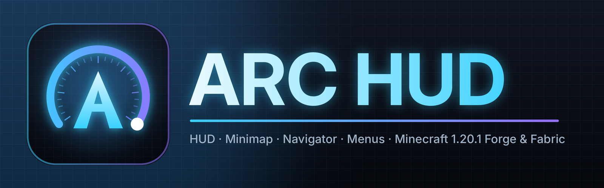

<p align="center"></p>

# Arc HUD — Minecraft 1.20.1 (Forge + Fabric)

**Автор:** arc4io · **Лицензия:** MIT · Описание для Modrinth (RU + EN): [docs/MODRINTH.md](docs/MODRINTH.md)

**Arc HUD** — единый стиль для всего интерфейса Minecraft: аккуратный HUD, своя мини-карта и карта мира
с навигатором и метками в мире, общая карта для сервера, панель хоста LAN, переработанные меню
(одиночная и сетевая игра, создание мира, настройки), оптимизация FPS, рюкзаки и интеграции с популярными модами.

*A unified style for the whole Minecraft UI: a polished HUD, a built-in minimap and world map with a navigator and
in-world waypoints, a shared server map, a LAN host panel, redesigned menus, FPS optimizations, backpacks and
integrations with popular mods.*

---

## Скачать

Готовые файлы — на странице **[Releases](https://github.com/astroffnet/arc-hud/releases/latest)**:

| Файл | Куда ставить |
|---|---|
| `archud-forge-1.20.1-1.2.0.jar` | клиент Forge 47+ / NeoForge 1.20.1 (и LAN-хост) |
| `archud-fabric-1.20.1-1.2.0.jar` | клиент Fabric (Loader 0.14.21+, Fabric API) |
| `archud-server-forge-1.20.1-1.2.0.jar` | выделенный сервер Forge |
| `archud-server-fabric-1.20.1-1.2.0.jar` | выделенный сервер Fabric |
| `archud-server-bukkit-1.2.0.jar` | плагин Bukkit / Spigot / Paper 1.20.1–1.21.x (папка `plugins`) |

Мод клиентский и работает сам по себе. Серверная сборка добавляет общую карту, синхронизацию и обмен метками,
глобальные метки, безопасный телепорт и двери Tempad. Что нового — в [docs/RELEASE_NOTES.md](docs/RELEASE_NOTES.md).

## Сборка из исходников

Нужен JDK 17. Каждый загрузчик собирается из своей папки:

```
cd forge  && gradle build     # forge/build/libs  — клиент и серверная сборка
cd fabric && gradle build     # fabric/build/libs — клиент и серверная сборка
cd bukkit && gradle build     # bukkit/build/libs — плагин
```

GitHub Actions (`.github/workflows/build.yml`) собирает всё при каждом push, а при теге `v*` публикует релиз.
Версия меняется в `mod_version` в `forge/`, `fabric/` и `bukkit/gradle.properties`.

## Структура

```
common/   — общий код и ресурсы (HUD, экраны, бхоп, рюкзаки, текстуры, языки)
forge/    — Forge 47.x: регистрация, сеть, оверлеи, Curios
fabric/   — Fabric (loader 0.16, API 0.92.2): регистрация, сеть, миксины, Trinkets, Mod Menu
bukkit/   — плагин для Bukkit / Spigot / Paper (серверная часть)
.github/workflows/ — сборка, тесты серверов и клиентов
```
Оба загрузчика используют официальные маппинги Mojang, поэтому `common/` компилируется в оба мода без изменений.

## Зависимости

| | Forge | Fabric |
|---|---|---|
| Обязательно | Forge 47+ | Fabric Loader 0.14.21+, Fabric API |
| Слоты спины / пояса / амулета | **Curios** (рекомендуется) | **Trinkets** (рекомендуется) |
| Кнопка «Моды» на главном экране | встроено | **Mod Menu** |

Без Curios/Trinkets рюкзаки работают из инвентаря (клавиша открывает первый найденный рюкзак).

## Клавиши (все переназначаются)

| Клавиша | Действие |
|---|---|
| **B** | открыть рюкзак (сначала на спине, потом в инвентаре / второй руке) |
| **H** | переключить Arc HUD ↔ ванильный HUD |
| **N** | включить / выключить BunnyHop |
| **J** | настройки Arc HUD (не K — на K у Iris/Oculus переключение шейдеров) |
| **M** | карта мира |
| **U** | поставить метку здесь |
| **Y** | меню меток (поиск, сортировка, DEL — удалить) |
| **=** / **-** | масштаб мини-карты |
| **~** | консоль (команды без слеша) |
| **F11** | полноэкранный в окне (без рамки) |
| — | панель хоста LAN (не назначена; есть кнопка в меню паузы) |
| — | сортировка инвентаря (по умолчанию не назначена, есть кнопка в инвентаре) |

## Что внутри

**HUD (50+ функций, каждая отключается):** полосы здоровья/голода/брони/воздуха/опыта с плавной анимацией,
поглощение, «след» урона, вспышка лечения, цвет HP от яда/иссушения/заморозки, виньетка при низком HP,
насыщенность, HP и прыжок скакуна, новый хотбар, слот второй руки, эффекты с таймерами, инфо-панель
(координаты, биом, измерение + мод, FPS, пинг, время, погода, скорость, свет), компас-лента с метками,
цель (моб + HP + мод), прочность брони и инструментов, счётчики стрел и тотемов, энергия предметов,
предупреждение о смертельном падении, цифры урона, подбор предметов, спидометр бхопа, темы измерений.
Каждый блок можно привязать к любому краю экрана.

**Карта и навигация:**
- своя мини-карта (квадратная или круглая) и карта мира (**M**) — отдельно для каждого измерения и пещерных слоёв,
  сохраняется на диск; ночное затемнение, сетка чанков, слизневые чанки, след игрока, экспорт в PNG;
- метки: свои, смерть (история из 5), спавн, Waystones, Tempad, от других игроков; фильтры, поиск, сортировка;
- **метки в мире** — экранные маркеры (ромб, подпись, расстояние) без наложений, карточка у прицела, стрелки у края экрана;
- **навигатор** — стрелка, расстояние, высота, время в пути, пересчёт координат Незер ↔ Верхний мир;
- **общая карта** (если Arc HUD на сервере / у хоста): все видят то, что исследовали другие, игроки за пределами
  прорисовки и зоны их прогрузки на карте; **обмен метками** с игроком или со всеми.

**Экраны в стиле Arc:** главное меню, **«Одиночная игра»** (карточки миров с иконками, поиск, подробности,
играть / изменить / пересоздать / удалить), **«Сетевая игра»** (иконки серверов, MOTD, пинг, онлайн, LAN,
**запоминание последнего сервера** с кнопкой «Продолжить»), добавление сервера и прямое подключение,
создание мира со всеми вкладками и подменю (правила игры, эксперименты, датапаки, редактирование мира) —
единый фон, поля ввода, флажки, вкладки и кнопки. Меню паузы, настройки (звук, чат, язык, внешний вид,
спец. возможности, ресурспаки), управление, достижения, статистика, «Открыть для сети», список модов (Forge),
инвентарь, чат.

**Панель хоста (LAN):** список игроков с пингом, кик, бан/разбан, оператор, режим игры, ТП к игроку / призвать,
вылечить, время, погода, сложность, PvP, игровые правила, белый список, сообщение всем, сохранение мира,
адрес для друзей и **закрытие игры для сети**.

**BunnyHop:** air-strafe по формуле Quake/Source, сохранение скорости при прыжке сразу после приземления.

**Рюкзаки:** кожаный (27), железный (36), алмазный (54); слот спины Curios / Trinkets, своя клавиша.

## Новое в 1.2.0

- **Глобальные метки** от оператора (видят все, удаляет только оператор), **обмен метками** с кнопками «Принять» / «Отклонить»,
  **скрытие любой метки** для себя, метки путеводных камней, надёжная метка смерти, метка кровати пропадает при её поломке.
- **Проверка карты при входе на сервер** — старые территории от пересозданного мира убираются.
- **Tempad:** дверь к любой метке и к игроку (дверь следует за ним), кнопка Tempad в инвентаре.
- **Консоль на «~»** (команды без слеша), **включение и выключение модов** из списка модов, **F11 — полноэкранный в окне**,
  сворачиваемая карточка характеристик в инвентаре.
- **Свой загрузчик шейдерпаков** из папки `shaderpacks` без OptiFine / Iris / Oculus (проходы composite и final).
- **Поддержка Arcium**, перчатки Aether двигаются вместе с анимациями рук (Punchy, Legends).
- **Облегчённые серверные сборки** для Forge, Fabric и Bukkit/Paper.

## Оптимизация

- **Сущности за стенами не рисуются** (occlusion culling): мобы, животные, предметы и т.п., полностью закрытые
  непрозрачными блоками, пропускаются. Вне поля зрения их и так отсекает игра. Игроки — по желанию.
- **Сундуки, таблички, баннеры, головы за стенами** тоже не рисуются (маяки и другие «дальнобойные» — всегда).
- **Дальность для декора**: рамки, картины и стойки для брони дальше 48 блоков (настраивается) не рисуются.
- **Динамический FPS**: в фоне — 15 кадров (настраивается), свёрнутая игра — 1 кадр.
- **Карта** сканирует мир реже, если FPS низкий.

Если установлен мод EntityCulling, своё отсечение Arc HUD отключается.

## Совместимость с модами

- **Aether, Twilight Forest, DivineRPG, Undergarden, Blue Skies и любые модовые измерения** — свои цвета темы и
  названия измерений; модовые сердца (например, осколки жизни из Aether) учитываются через макс. здоровье.
- **HUD других модов (Forge):** Arc HUD сообщает Forge, сколько места он занимает снизу, и модовые полосы
  (мана, аркана и т.п.) встают выше. Мешающий оверлей можно скрыть: добавь его id в `hiddenOverlays`
  в `config/archud.json`, например `"divinerpg:arcana"`.
- **Энергия:** Forge Energy (любые технические моды, включая порты IC2/BuildCraft) + чтение NBT-тегов
  `Energy`/`charge` — подходит для IC2-подобных предметов на обоих загрузчиках.
- **AzureLib** — библиотека анимаций, HUD не трогает, конфликтов нет.
- **Legends Core** — мана и выносливость в HUD Arc, панель способностей.
- **Waystones** — вэйстоуны как метки, уведомление о новом вэйстоуне.
- **Tempad** — локации как метки (сервер присылает сам), временная дверь к любой метке или точке карты в любом измерении, заряд Tempad
  (в том числе в слоте браслета Curios / Trinkets).
- **Ad Astra** — кислород, энергия костюма, планета.
- **Regeneration (Doctor Who)** — регенерации, состояние, особенность (трейт) и её баф, карточка в меню мода.
- **Simple Voice Chat / Plasmo Voice** — статус микрофона, «вы говорите», группа, говорящие игроки на карте.
- **SkinsRestorer** — экран смены скина.
- **AppleSkin** — предпросмотр еды в руке на полосе голода (голод и насыщенность) и полоса истощения.
- **Моды про супергероев / свои ресурсы:** публичный API для своей полосы в стиле Arc HUD:
  ```java
  ArcHudApi.registerBar(new ResourceLocation("mymod", "energy"), Component.literal("Энергия"), 0xFF7E57C2,
          () -> new float[]{ currentEnergy(), maxEnergy() });
  ```

## Настройки

Экран настроек: клавиша **J**, кнопка на главном экране, «Настроить» в списке модов. Файл — `config/archud.json`.

## Моды рендера и шейдеров

- **Arcium, Embeddium / Rubidium (Forge), Sodium (Fabric)** — «Настройки → Графика» открывает их экран настроек;
  если в Arcium включён CIT, свой CIT Arc HUD выключается автоматически.
- **Без OptiFine / Iris / Oculus** — встроенный загрузчик шейдерпаков (Настройки → Графика → Эффекты → Шейдерпаки).
- **Oculus (Forge), Iris (Fabric), OptiFine** — плитка «Шейдеры» в настройках открывает меню шейдеров;
  название активного шейдерпака показывается в инфо-панели HUD.
- Клавиша настроек Arc HUD — **J** (K занята Iris/Oculus).
