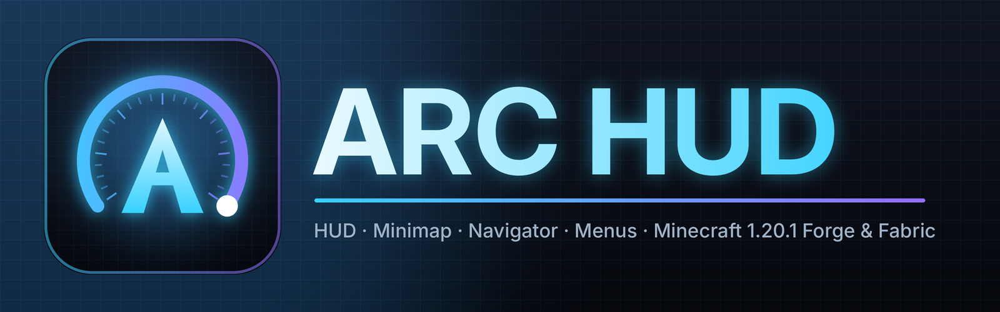

## Arc HUD 1.2.0 — Minecraft 1.20.1 (Forge / NeoForge 1.20.1 / Fabric) + серверная часть

**Автор:** arc4io · **Лицензия:** MIT · **Исходники:** архивы «Source code» внизу релиза

**Файлы / Files**
- `archud-forge-1.20.1-1.2.0.jar` — клиент (и LAN-хост) для Forge 47+ и NeoForge 1.20.1
- `archud-fabric-1.20.1-1.2.0.jar` — клиент для Fabric Loader 0.14.21+ и Fabric API
- `archud-server-forge-1.20.1-1.2.0.jar`, `archud-server-fabric-1.20.1-1.2.0.jar` — облегчённые сборки только для выделенного сервера (без HUD, карты, экранов и клиентских библиотек)
- `archud-server-bukkit-1.2.0.jar` — плагин для Bukkit / Spigot / Paper 1.20.1–1.21.x

### 🇷🇺 Новое в 1.2.0

**Метки и карта**
- **Глобальные метки:** оператор создаёт метку, которую сразу видят все игроки; удалить её может только оператор.
- **Обмен метками с подтверждением:** уведомление с кнопками «Принять» и «Отклонить» в чате и над HUD.
- **Скрыть любую метку для себя** — кнопкой-глазом в списке или из меню на карте.
- **Метка смерти** создаётся всегда, в том числе при мгновенном возрождении; «Вы прибыли» больше не срабатывает сразу после смерти.
- **Метка кровати** исчезает, когда кровать сломана; **путеводные камни** (привязанные компасы) — тоже метки.
- **Проверка карты при входе на сервер:** если мир пересоздан или сервер другой, старые территории убираются (копия сохраняется в `config/archud/map_removed`).
- Метки на сервере хранятся по нику; при /login и /register метки, карта и позиции игроков отдаются только после входа.

**Tempad**
- Дверь к любой метке: путеводный камень, кровать, точка смерти, глобальная или общая метка, легенда на карте.
- Дверь к игроку ведёт к его текущей позиции и следует за ним, пока открыта.
- Кнопка Tempad в инвентаре выживания (если Tempad в инвентаре или в слоте браслета).

**Интерфейс**
- **Консоль на «~»** как в играх на Source: команды без слеша, история, автодополнение по Tab.
- **Включение и выключение модов** прямо из списка модов (кроме fabric-api, e4mc и самого Arc HUD) с перезапуском игры.
- **F11 — полноэкранный в окне** (без рамки, мгновенный Alt+Tab); обычный полноэкранный режим остался в настройках видео.
- Кнопка сворачивания карточки характеристик в инвентаре.
- Список предметов (замена JEI) прижат к правому краю и не перекрывает подсказки окон.
- Исправлены: подпись «Мир сохранён (%s)», свечение логотипа в главном меню, мигание списка предметов.
- Убрана «Полная яркость».

**Графика**
- **Свой загрузчик шейдерпаков** из папки `shaderpacks` без OptiFine, Iris и Oculus (проходы composite и final; без теней и gbuffers).
- **Поддержка Arcium:** название рендера, открытие экрана настроек Arcium; CIT Arc HUD сам выключается, если включён CIT в Arcium.
- Перчатки Aether следуют за анимациями рук (Punchy, Legends) от первого и третьего лица; отключение круглой тени под сущностями.

**Сервер**
- Отдельные облегчённые сборки для Forge, Fabric и Bukkit/Paper.
- Админ-панель (более 60 действий), AntiESP, данные игроков по нику.
- Приглашения через Steam: точнее определяется, запущен ли Steam.

### 🇬🇧 What's new in 1.2.0

- **Global waypoints** created by operators and visible to every player; only operators can delete them.
- **Waypoint sharing with Accept / Decline**, hide any waypoint for yourself, reliable death waypoints, bed waypoints removed when the bed breaks, lodestone compasses as waypoints.
- **Map check on join:** stale map areas from a recreated world are removed (a copy is kept).
- **Tempad doors to any waypoint** and to a player that follow them while open; a Tempad button in the inventory.
- **Source-style console** on `~`, **enable / disable mods** from the mod list, **F11 borderless fullscreen**, a collapsible stats card in the inventory.
- **Built-in shader pack loader** without OptiFine / Iris / Oculus (composite and final passes only).
- **Arcium support** (renderer name, options screen, automatic CIT hand-off).
- Aether gloves follow arm animations; optional removal of the round entity shadow.
- **Slim server builds** for Forge, Fabric and Bukkit/Paper; admin panel, AntiESP, per-name player data.
- Fixes: save label, title logo glow, item list flicker and tooltips covered by the item list. Fullbright removed.

The client mod works on its own; installing the server build adds the shared map, waypoint sync and sharing, global waypoints, safe teleports and Tempad doors.
